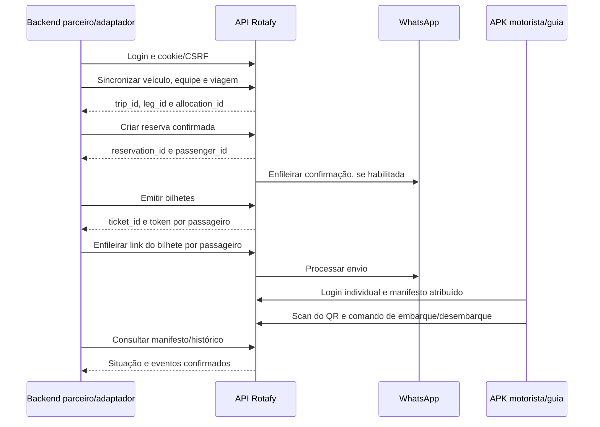

# Rotafy — Integração de WhatsApp, bilhetes e embarque

**Versão do guia:** 1.1 · **Revisão:** 21/10/2026

Este guia descreve endpoints existentes no Rotafy para integrar um sistema que já vende viagens e pacotes à comunicação por WhatsApp e ao controle de embarque/desembarque pelo APK. A empresa parceira mantém seu sistema de vendas como origem dos dados; um adaptador sincroniza os registros operacionais necessários no Rotafy.

**Base de produção:** `https://rotafy.nexusdataanalytics.tech/api/v1`. Os caminhos abaixo são relativos a essa base. O ambiente de homologação deve ser informado pela Nexus; este guia não presume que exista um domínio de testes publicado.

Arquivos de apoio:

- [OpenAPI JSON](openapi.json): rotas e esquemas extraídos da aplicação, com autenticação e observações de integração.
- [Coleção Postman](rotafy.postman_collection.json): sequência de chamadas com variáveis, sem credenciais reais.
- [Exemplos JSON](exemplos.json): corpos de requisição com IDs fictícios.
- [Versão HTML](guia.html) e [versão PDF](guia.pdf).

Na coleção Postman, preencher `base_url`, `origin`, `company` e as credenciais locais de cada perfil. A pasta de preparação exige administrador; a sincronização usa a conta técnica; a reprodução do APK usa motorista/guia atribuído. Manter o cookie jar habilitado. Os testes da coleção guardam IDs, CSRF e credenciais emitidas nas variáveis da sessão de trabalho: não compartilhar uma exportação preenchida. As UUIDs `operation_key_*` de exemplo devem ser renovadas para um novo comando de negócio e preservadas em uma repetição do mesmo comando.

## 1. Escopo e condições de uso

O fluxo servidor a servidor pode usar uma chave operacional Bearer `ri`, com permissões por operação, empresa e validade. Usuários e o APK continuam usando sessão com cookies e CSRF. A chave Bearer legada `rk` atende somente reservas externas temporárias; não deve ser confundida com a chave operacional. Consulte a seção 15 para configurar módulos, emitir a chave `ri` e sincronizar os eventos de embarque.

O contrato descrito não cria um usuário de passageiro nem exige que ele instale aplicativo: o passageiro recebe o link do bilhete e apresenta seu QR Code. Motorista e guia utilizam o APK Rotafy, com suas próprias credenciais e alocação na viagem.

Os endpoints não recebem um pacote arbitrário de dados para “mandar uma mensagem”. Mensagens e bilhetes são derivados de viagem, reserva e passageiro registrados no Rotafy. O adaptador cria esses registros automaticamente, evitando cadastro manual duplicado.

A configuração de módulos por empresa está disponível ao Superadmin em **Módulos por empresa**. O perfil **WhatsApp e embarque integrado** mantém Equipe, Veículos, Viagens, WhatsApp, Bilhetes/embarque e Integrações; as vendas permanecem no parceiro. A autenticação, as regras de assinatura/franquia, capacidade, perfil operacional e permissões continuam valendo. A integração não cria isenção de consumo ou cobrança.

### Responsabilidade por dados

| Informação | Origem e responsabilidade |
|---|---|
| Venda, preço, passageiro e cancelamento comercial | Sistema parceiro |
| Sincronização e relacionamento entre IDs | Adaptador do parceiro |
| Credencial do bilhete, validação e fila de mensagens | Rotafy |
| Embarque/desembarque realizado em campo | Operador identificado no APK |
| Retorno da situação ao sistema parceiro | Consulta periódica pelo adaptador |

O retorno de embarques/desembarques está disponível por consulta ao feed paginado com cursor, descrito na seção 15. Não há webhook desses eventos ou de mensagens. O webhook de pagamentos não serve para esses eventos.

## 2. Preparação pela Nexus e pelo administrador da empresa

1. Provisionar uma empresa ativa no Rotafy, com identificador de acesso, perfil operacional, assinatura e capacidade operacional compatíveis.
2. Concluir eventual aceite contratual e regularizar bloqueios financeiros que impeçam novas operações.
3. Criar um usuário técnico da **própria empresa**, preferencialmente com perfil `attendant`, para sincronizar viagens, reservas, bilhetes e mensagens. Ele não deve usar credenciais de Superadmin Nexus.
4. O administrador cria os motoristas/guias com contas individuais e os veículos. A API também permite automatizar esses cadastros usando uma sessão administrativa, separada da conta técnica.
5. O administrador conecta o WhatsApp da empresa e habilita os envios. O número remetente vem do cadastro da empresa. Ler o QR de conexão do WhatsApp é uma ação do responsável pelo número; esse QR não é um bilhete de passageiro.
6. Instalar o APK atual pelo download disponível na ajuda ou pela publicação do Superadmin. Usar o mesmo identificador de empresa no login dos operadores.

Credenciais do provedor de WhatsApp e configurações globais pertencem à Nexus; não devem ser entregues ao parceiro nem incluídas no aplicativo dele.

## 3. Autenticação operacional

### 3.1 Login

`POST /auth/login`

```json
{
  "company": "empresaexemplo",
  "email": "integracao@example.com",
  "password": "SENHA_DO_USUARIO_TECNICO"
}
```

Enviar `Content-Type: application/json` e `Origin: https://rotafy.nexusdataanalytics.tech`. A resposta `200` contém os dados do usuário; a autenticação é entregue por `Set-Cookie`, não por um campo `access_token` no JSON.

| Cookie/header | Uso |
|---|---|
| `rotafy_session` | Cookie de sessão; HttpOnly, Secure em produção e SameSite=Lax |
| `rotafy_csrf` | Cookie com o valor de proteção CSRF |
| `X-CSRF-Token` | Repetir o valor de `rotafy_csrf` nas operações autenticadas de escrita |
| `Origin` | Obrigatório nas operações de escrita; deve corresponder a uma origem permitida pelo servidor |

Para autenticação por sessão, guardar cookies em um cookie jar seguro. A validade é configurável na implantação; o padrão do código é oito horas. `GET /auth/me` valida a sessão e informa o usuário, empresa, perfil e eventuais bloqueios. `POST /auth/logout` encerra a sessão e retorna `204`.

A integração deve ocorrer **do backend do parceiro para o backend Rotafy**. Não embutir a senha técnica em JavaScript público ou no APK do parceiro. Não assumir que um navegador em outro domínio poderá reutilizar esses cookies; CORS e SameSite não constituem uma API pública entre sites.

Em `401`, autenticar novamente e repetir a mesma operação com a mesma chave de idempotência. Não repetir login a cada chamada. Em `402`, `403` ou `423`, tratar a restrição; um novo login não a remove.

### 3.2 Exemplo de transporte

```http
POST /api/v1/reservations/{reservation_id}/whatsapp HTTP/1.1
Host: rotafy.nexusdataanalytics.tech
Content-Type: application/json
Origin: https://rotafy.nexusdataanalytics.tech
Cookie: rotafy_session=VALOR_DA_SESSAO; rotafy_csrf=VALOR_CSRF
X-CSRF-Token: VALOR_CSRF

{"operation_key":"aaaaaaaa-0000-4000-8000-000000000003"}
```

Os valores acima são ilustrativos. O cookie deve ser obtido no login, nunca montado ou assinado pelo parceiro.

## 4. Dados mínimos e identificação

### 4.1 Entidades

| Entidade | Dados necessários | Identificador retornado |
|---|---|---|
| Empresa | Provisionada pela Nexus; identificador de acesso no login | `company_id` |
| Colaborador | Nome, e-mail, senha inicial e papel; motorista/guia para operação | `id` de usuário |
| Veículo | Nome, placa e capacidade | `vehicle_id` |
| Viagem comercial | Nome, destino, modalidade, preço, trechos e veículos/equipe | `trip_id` |
| Trecho/deslocamento | Origem/destino com cidade IBGE, datas e horários, endereços e paradas | `leg_id` |
| Veículo na viagem | Veículo físico e equipe atribuída aos trechos | `allocation_id` |
| Reserva familiar | Responsável, telefone, passageiros, trechos e veículo | `reservation_id` |
| Passageiro | Nome; CPF opcional; dados adicionais quando aplicáveis | `passenger_id` |
| Bilhete | Emitido pelo Rotafy para passageiro/reserva | `ticket_id` e credencial `token` |
| Comando de presença | Passageiro, veículo na viagem, trecho, ação e versão | `id` do evento |

**`vehicle_id` e `allocation_id` não são intercambiáveis.** Os caminhos de manifesto e embarque usam `allocation_id` em `/vehicles/{allocation_id}`. O mesmo veículo físico pode ter alocações distintas.

### 4.2 Mapeamento no adaptador

Manter uma tabela local com `empresa`, `tipo_entidade`, `id_no_parceiro`, `id_rotafy`, versão sincronizada e situação. Usar chave única por empresa/tipo/ID externo. Exemplos: viagem externa → `trip_id`; deslocamento externo → `leg_id`; reserva externa → `reservation_id`; passageiro externo → `passenger_id`.

Os corpos operacionais não possuem um campo genérico `external_id`, e campos não reconhecidos são rejeitados (`422`). Não usar nome ou CPF como chave de sincronização: nomes repetem, CPF é opcional e a mesma pessoa pode viajar mais de uma vez. O relacionamento do passageiro deve incluir a reserva quando o sistema parceiro tiver um cadastro global de pessoas.

### 4.3 Convenções

- IDs internos e `operation_key` são UUIDs.
- Valores monetários são inteiros em centavos: `12000` representa R$ 120,00.
- Datas operacionais incluem fuso: `2026-12-10T08:00:00-03:00`. Não enviar datas sem offset.
- Telefone preferencialmente em E.164: `+5511999999999`. Um telefone atende à reserva familiar; o sistema não escolhe um telefone diferente por passageiro nessa mesma reserva.
- Nomes da empresa, do responsável e do passageiro são distintos; informar cada um corretamente para as mensagens.
- Menor de cinco anos exige `under_five: true` e `birth_date` em `AAAA-MM-DD`. CPF, quando fornecido, é validado; estrangeiro usa `is_foreign` conforme o cadastro real.

## 5. Sequência de integração



O diagrama representa chamadas e processamento assíncrono, não confirmação de entrega do WhatsApp.

## 6. Sincronizar a operação

### 6.1 Colaboradores, veículos e localidades

| Método e caminho | Perfil | Finalidade |
|---|---|---|
| `GET /users` | Administrador | Consultar colaboradores |
| `POST /users` | Administrador | Criar colaborador |
| `PATCH /users/{user_id}` | Administrador | Editar dados, função ou situação conforme esquema |
| `GET /operations/crew` | Admin/atendente | Consultar motoristas e guias disponíveis |
| `GET /vehicles` | Admin/atendente | Consultar veículos |
| `POST /vehicles` | Admin/atendente | Criar veículo |
| `PUT /vehicles/{vehicle_id}` | Admin/atendente | Atualizar os dados do veículo |
| `GET /locations/states` | Público | Listar UFs |
| `GET /locations/cities/{uf}` | Público | Listar municípios e IDs IBGE |

Exemplos completos: `create_driver` e `create_vehicle` em `exemplos.json`. A senha inicial do colaborador deve atender à política: pelo menos oito caracteres, uma letra maiúscula e um caractere especial. O exemplo público não é uma senha de produção.

### 6.2 Viagem e alocações

`POST /trips` → `201`. Corpo `create_trip` em `exemplos.json`.

Campos obrigatórios: `operation_key`, `name`, `destination`, `mode`, `price_cents`, `legs` e `vehicles`. Para cada trecho, informar `origin`, `destination`, `origin_city_id`, `destination_city_id`, `starts_at` e `ends_at`. Os IDs IBGE de origem/destino são exigidos na criação. UF e nomes são validados contra esses IDs; a chegada deve ser posterior à saída.

Em `vehicles`, usar `vehicle_id`, pelo menos um `driver_ids` e, quando aplicável, `guide_ids`. Uma pessoa ou um veículo não pode ser duplicado no mesmo trecho. A API valida conflito de agenda. `leg_positions` vazio significa todos os trechos; posições explícitas começam em **1**.

`one_way` exige um trecho; `round_trip` exige dois, com a volta invertendo as cidades e começando após a chegada da ida. `multi_destination` exige o pacote com roteiro completo e regras de turismo; não é um atalho para enviar uma lista arbitrária de destinos. O exemplo de ida e volta não exige criar uma Rota reutilizável ou um pacote modelo no Rotafy.

Guardar `id` como `trip_id`, `legs[].id` como `leg_id` e `vehicles[].id` como `allocation_id`. Consultar `GET /trips/{trip_id}` para obter a estrutura completa. Não deduzir esses IDs pelo veículo físico nem pela ordem de uma lista sem conferir `position`.

`GET /trips` lista as viagens visíveis ao usuário. Os estados de API são `scheduled`, `in_progress`, `completed` e `cancelled`. A classificação visual “Aberta” nas 48 horas anteriores à saída não é um novo valor aceito no campo `status` da API.

### 6.3 Reserva e passageiro

1. `POST /trips/{trip_id}/availability`, com `{"group_size":1}`, consulta capacidade e retorna `suggested_allocation_id`, `vehicles` e `can_book`.
2. `POST /trips/{trip_id}/reservations` → `201`, usando `create_reservation` em `exemplos.json`.
3. Guardar `id`, `passengers[].id` e `leg_allocations[].allocation_id`. Consultar `GET /reservations/{reservation_id}` para reconciliar o registro.

Campos principais: `operation_key`, `contact_name`, `phone`, `passengers`; informar `status:"confirmed"` quando a venda do parceiro já estiver confirmada. `allocation_id` escolhe o veículo na viagem, sujeito à capacidade. Se omitido, a API escolhe uma alocação compatível; conferir o resultado em vez de presumir um veículo.

`journeys` deve contemplar **todos os trechos**, inclusive volta. Se omitido, usa origem e destino completos de cada trecho. As posições dentro de um trecho são: origem `0`; paradas `1…N`; destino `N+1`. São diferentes das posições dos trechos, que começam em 1. No exemplo sem paradas, embarque `0` e desembarque `1`.

Para buscar no hotel, informar `boarding_location` com `name`, `address`, `complement` opcional e `order`. Não inserir hotel como um novo destino comercial. `dropoff_location` aceita a mesma estrutura para desembarque personalizado.

A criação só aceita novas reservas antes da saída, com viagem ainda `scheduled`, capacidade e cadastro geográfico completos. Não é uma importação livre de passageiros para uma viagem já encerrada ou iniciada.

**Preço:** o valor total atual é calculado por `price_cents` da viagem × quantidade de passageiros. Não enviar um `total_cents` externo no corpo: ele não é um campo aceito. Antes de automatizar mensagens financeiras, conferir a compatibilidade com descontos e preços individuais do parceiro.

## 7. Mensagens por WhatsApp

### 7.1 Gatilhos existentes

| Ação | Endpoint | Efeito na comunicação |
|---|---|---|
| Criar reserva confirmada | `POST /trips/{trip_id}/reservations` | Enfileira confirmação quando o WhatsApp está habilitado |
| Confirmar reserva pendente válida | `PATCH /reservations/{reservation_id}/status` com `confirmed` | Enfileira confirmação |
| Cancelar reserva | Mesmo endpoint com `cancelled` | Enfileira cancelamento |
| Registrar pagamento | `PATCH /reservations/{reservation_id}/payment` com `{"is_paid":true}` | Enfileira aviso PAGO quando muda para pago |
| Reenviar resumo | `POST /reservations/{reservation_id}/whatsapp` | Enfileira resumo manual; requer `operation_key` |
| Enviar bilhete | `POST /tickets/{ticket_id}/whatsapp` | Enfileira link individual; requer `token` e `operation_key` |

Não disparar um resumo manual imediatamente após uma confirmação automática apenas para obter a mesma mensagem: isso pode produzir dois avisos. A criação bem-sucedida da reserva não garante que uma mensagem tenha sido enfileirada se o WhatsApp não estiver habilitado. Consultar o histórico.

O conteúdo do resumo identifica empresa, responsável e passageiros, viagem, saída, quantidade, valor, referência e situação. O bilhete identifica seu passageiro. Esses endpoints não aceitam um texto livre, telefone arbitrário ou template externo; o telefone é o da reserva.

### 7.2 Envio manual

`POST /reservations/{reservation_id}/whatsapp`

```json
{"operation_key":"aaaaaaaa-0000-4000-8000-000000000003"}
```

Resposta `202`:

```json
{"id":"0000000b-0000-4000-8000-00000000000b","status":"pending"}
```

`202` significa aceitação na fila do Rotafy. Não significa entregue ou lido pelo passageiro.

### 7.3 Situação dos envios

`GET /reservations/{reservation_id}/whatsapp` retorna até **30 registros**, mais recentes primeiro: `id`, `kind`, `status`, `attempts`, `error_code`, `created_at` e `sent_at`. O corpo privado da mensagem não é retornado.

| Status | Tratamento |
|---|---|
| `pending` | Aguardando processamento ou nova tentativa permitida |
| `sending` | Processamento em andamento |
| `sent` | Aceito pelo provedor; não comprova entrega/leitura |
| `failed` | Falha registrada; consultar `error_code` |
| `uncertain` | Não foi possível confirmar a aceitação; conferir antes de reenviar |
| `discarded` | Aviso expirado ou deixou de ser válido |

Preservar o `id` da fila para reconciliar o comando. A mesma `operation_key` no mesmo tipo de envio evita repetição; uma nova chave representa novo pedido. Não transformar `uncertain` em uma nova tentativa automática com outra chave.

## 8. Bilhete individual e QR Code

### 8.1 Emitir

`POST /reservations/{reservation_id}/tickets`, sem corpo → `201`.

Trecho ilustrativo da resposta:

```json
{
  "issued": [
    {
      "id":"0000000a-0000-4000-8000-00000000000a",
      "full_name":"Passageiro Exemplo",
      "leg_id":"00000006-0000-4000-8000-000000000006",
      "token":"bt.00000001-0000-4000-8000-000000000001.AAAAAAAAAAAAAAAAAAAAAAAAAAAAAAAAAAAAAAAAAAA"
    }
  ]
}
```

O exemplo de token é fictício. A resposta pode conter **uma linha por passageiro/trecho**, com o **mesmo token nos trechos do mesmo passageiro**. Agrupar por token e enviar um bilhete por passageiro, não um envio por linha da resposta. Não agrupar por nome, pois pode haver homônimos.

Para relacionar a emissão ao passageiro, `GET /reservations/{reservation_id}/tickets` retorna `id`, `passenger_id`, `leg_id` e demais dados de situação. Relacionar pelo `ticket_id`. O `token` em texto claro só é disponibilizado na emissão/reemissão, não nessa listagem.

Se o bilhete já está emitido, uma nova emissão pode retornar `issued:[]`. Isso não recupera o segredo existente. Preserve a credencial com proteção apropriada ou use reemissão controlada quando for necessário gerar outra; não reemita em todo ciclo de sincronização.

### 8.2 Link e envio

`POST /tickets/{ticket_id}/whatsapp`

```json
{
  "operation_key":"aaaaaaaa-0000-4000-8000-000000000004",
  "token":"bt.00000001-0000-4000-8000-000000000001.AAAAAAAAAAAAAAAAAAAAAAAAAAAAAAAAAAAAAAAAAAA"
}
```

O Rotafy constrói o link público compatível com Android/iOS, no formato `/api/v1/public/bilhete/{codigo_alfanumerico}`. Não enviar link do portal de acesso ou de redefinição de senha no lugar do bilhete.

O passageiro abre a página sem login. Ela mostra o QR cujo conteúdo é **exatamente o token emitido**. Se o parceiro renderizar o QR em sua própria interface, codificar esse token, sem criar outro identificador ou incluir CPF e dados pessoais no QR. A decisão de validade é do Rotafy; gerar a imagem não cria uma credencial válida.

A API não retorna diretamente uma imagem PNG do QR nem um `ticket_url` no JSON de emissão. Para enviar via WhatsApp, usar o endpoint acima. Para montar a URL em um backend Python autorizado, a função de referência é `app.ticket_links.ticket_url(base_url, token)`; a página antiga `/bilhete#token=...` permanece reconhecida, mas o formato alfanumérico é o utilizado nos novos envios.

### 8.3 Reemitir e revogar

- `POST /tickets/{ticket_id}/reissue` → `200`, `{"token":"NOVA_CREDENCIAL"}`. Substitui a credencial para todos os trechos desse passageiro na reserva; o QR anterior deixa de valer.
- `POST /tickets/{ticket_id}/revoke` → `204`. Revoga o bilhete do passageiro nessa reserva, incluindo seus trechos.
- Cancelar a reserva ou encerrar a viagem também impede o uso operacional, conforme as validações de estado.

Não existe garantia global de “QR nunca reutilizado”: o mesmo bilhete serve para a volta e outros trechos contratados. O controle de uso é por passageiro, veículo e trecho, com estado e versão.

## 9. APK e operações de campo

### 9.1 Distribuição e login

`GET /public/mobile-version?package_id=br.com.nexusdataanalytics.rotafy` é público. Retorna `{"android":null}` quando não há arquivo publicado; caso exista, o objeto contém `version`, `build`, `sha256` e `download_url`. Usar a URL retornada, não um caminho fixo para o APK.

O arquivo é Android; não é instalável no iPhone. O APK atual utiliza a API e o login da própria empresa. O operador entra com usuário `driver` ou `guide` e precisa estar atribuído ao veículo/trecho. Não compartilhar a conta técnica de sincronização entre os motoristas.

### 9.2 Carregar a lista de passageiros

Prefixo operacional:

```text
/trips/{trip_id}/vehicles/{allocation_id}/legs/{leg_id}
```

`GET {prefixo}/manifest` retorna `trip`, `vehicle`, `leg`, `journey`, `passengers`, `counts` e `can_write`. Cada passageiro contém `id`, `full_name`, `status`, `version`, dados de embarque/desembarque e locais personalizados quando informados.

Estados de presença: `waiting` = aguardando; `onboard` = a bordo; `alighted` = desembarcado. Não confundir com o estado comercial da reserva ou da viagem.

### 9.3 Conferir o QR

`POST {prefixo}/scan`, corpo `scan` de `exemplos.json`:

```json
{"token":"bt.00000001-0000-4000-8000-000000000001.AAAAAAAAAAAAAAAAAAAAAAAAAAAAAAAAAAAAAAAAAAA"}
```

Resposta `200` inclui `passenger_id`, `full_name`, `boarding_status` e `version`. **Scan não registra embarque.** Ele confere a credencial e retorna a situação; o operador deve confirmar o comando seguinte.

### 9.4 Registrar embarque

`POST {prefixo}/boarding` → `201`:

```json
{
  "operation_key":"aaaaaaaa-0000-4000-8000-000000000005",
  "passenger_id":"00000009-0000-4000-8000-000000000009",
  "expected_version":0,
  "action":"board",
  "token":"bt.00000001-0000-4000-8000-000000000001.AAAAAAAAAAAAAAAAAAAAAAAAAAAAAAAAAAAAAAAAAAA",
  "device_id":"aparelho-exemplo-01",
  "offline":false
}
```

Resposta ilustrativa:

```json
{"id":"0000000c-0000-4000-8000-00000000000c","status":"onboard","version":1,"replayed":false}
```

Usar a versão retornada pelo manifesto/scan, não assumir que seja sempre zero. Se uma resposta se perder, repetir **o mesmo corpo, usuário e `operation_key`**; o Rotafy retorna o evento já processado com `replayed:true`. Isso não é outro embarque.

O token é opcional no esquema para permitir operação manual autorizada. Quando presente, deve corresponder ao passageiro, viagem, veículo e trecho; a origem do evento é registrada como `qr`. Sem token, a origem é `manual`. O APK oferece a leitura do QR e os controles de presença.

### 9.5 Registrar desembarque e corrigir

No mesmo endpoint, enviar `action:"disembark"`, a versão atual e **outra** `operation_key`. Exemplo completo: `disembark` em `exemplos.json`. O resultado normal é `status:"alighted"`, versão incrementada.

Transições aceitas:

| Estado atual | Ação | Novo estado |
|---|---|---|
| `waiting` | `board` | `onboard` |
| `onboard` | `disembark` | `alighted` |
| `onboard` | `reverse` | `waiting` |
| `alighted` | `reverse` | `onboard` |

Uma segunda tentativa de embarque já a bordo, com uma nova chave, não cria uma presença duplicada: recebe conflito. O APK atual oferece embarque/desembarque e desembarque em lote pela interface; este contrato não define um endpoint separado de “desembarcar todos”.

### 9.6 Início e chegada do trecho

`PATCH {prefixo}/journey` com `{"status":"in_progress"}` inicia a operação; com `{"status":"completed"}` registra a chegada. São ações online. A volta exige concluir o trecho anterior; não é concluída automaticamente com a ida. A chegada não pode ser confirmada com passageiros a bordo: desembarcar e sincronizar primeiro.

`arrival_location` é opcional no comando de chegada e aceita coordenadas ou motivo de indisponibilidade, conforme o OpenAPI. O APK tenta capturar GPS, mas a indisponibilidade não inventa uma posição. A conclusão de todos os veículos/trechos pode concluir a viagem comercial; não fechar a viagem global após a chegada de apenas um veículo.

### 9.7 Offline

`GET {prefixo}/offline-manifest` prepara o trecho quando há conexão. A resposta acrescenta `operator`, `tickets` com hashes, `prepared_at` e `expires_at`. A validade é o menor valor entre o vencimento da sessão e oito horas a partir da preparação.

O APK conserva a lista e a fila local, projeta estados pendentes e sincroniza os comandos pelo endpoint de `boarding` com `offline:true`, `captured_at`, `device_id` e `expected_actor_id`. Revogações, cancelamentos e mudanças feitas por outro aparelho são revalidados na sincronização. A tela local não prova que o backend já aceitou o evento.

Uma leitura offline não pode descobrir um cancelamento ocorrido depois da preparação. Se o servidor recusar o comando, o operador precisa revisar o conflito. Preparar/sincronizar com frequência e antes de sair da área com conexão.

## 10. Retornar embarques ao sistema parceiro

### 10.1 Consultas disponíveis

- `GET {prefixo}/manifest`: estado atual dos passageiros naquele veículo/trecho.
- `GET {prefixo}/boarding-history`: até **200 eventos**, mais recentes primeiro, com `id`, `passenger_id`, `full_name`, `action`, `previous_status`, `status`, `version`, `source`, `created_at`, `client_recorded_at`, `is_offline` e `actor_name`.

`created_at` é o registro recebido no servidor. `client_recorded_at` é o horário informado pelo aparelho quando presente. Conservar ambos; um evento offline pode chegar depois de sua captura.

### 10.2 Sincronização recomendada

Para sincronização completa, prefira o feed paginado da seção 15.3. A alternativa limitada é consultar os trechos ativos a cada 15–30 segundos, sem abrir uma sessão por chamada. Relacionar cada `passenger_id` à reserva/pessoa do parceiro e aplicar o maior `version` confirmado para o contexto passageiro/trecho. Preservar o `id` do evento como chave de deduplicação.

O histórico vem em ordem decrescente. Para aplicar uma sequência de transições, reordenar por versão por passageiro/trecho, não simplesmente processar a ordem recebida. Uma reversão é outro evento e não deve ser descartada apenas porque já houve embarque anterior.

O endpoint de histórico não possui cursor, filtro `since` ou paginação. Se mais de 200 eventos ocorrerem entre consultas, não é possível garantir a cópia de todo o histórico por ele. Reconciliar a situação atual pelo manifesto; não prometer ao parceiro uma trilha de eventos completa baseada apenas nessa janela limitada. O mesmo cuidado vale para a janela de 30 mensagens por reserva.

## 11. Alterações, cancelamento e idempotência

| Operação | Regra |
|---|---|
| `PATCH /trips/{trip_id}` | Corpo completo `TripEdit`, com `expected_version`; não é patch de um único campo |
| `PATCH /reservations/{reservation_id}` | Corpo `ReservationEdit`, com `expected_version` e IDs dos passageiros já existentes |
| `PATCH /reservations/{reservation_id}/vehicle` | Corpo `{"allocation_id":"UUID"}`; remaneja sujeito a capacidade e estado |
| `PATCH /reservations/{reservation_id}/status` | `confirmed` ou `cancelled`, conforme estado atual |
| `PATCH /trips/{trip_id}/status` | `in_progress`, `completed` ou `cancelled`; sujeito às regras operacionais |

Consultar os detalhes antes de editar e usar `edit_version` da viagem ou da reserva em `expected_version`. Esse contador de edição é diferente do `version` da presença de cada passageiro no embarque. Preservar IDs de passageiros e alocações. Não apagar e recriar reservas como mecanismo normal de sincronização: isso altera identidade, referências e bilhetes.

`operation_key` garante idempotência em operações que a recebem. Gere uma UUID por comando de negócio e persista antes da primeira chamada; reutilize-a somente ao repetir o mesmo comando. Reutilizar a chave com outro conteúdo pode receber `409`. Os endpoints que não recebem essa chave não devem ser presumidos idempotentes; emissão/reemissão de bilhete exige o tratamento específico da seção 8.

Um cancelamento comercial deve ser sincronizado antes de permitir novos embarques. Uma reserva com passageiros a bordo pode ter o cancelamento recusado. Mudanças após embarques e edições que alterem ocupação são limitadas; tratar o conflito, não forçar o estado por SQL.

## 12. Chave Bearer de reservas externas — escopo limitado

O administrador da empresa pode usar `POST /integrations/keys`, corpo `{"name":"Parceiro Exemplo","valid_days":90}`, para criar uma chave. A resposta traz `id` e `token`; guardar o segredo nessa ocasião. `GET /integrations/keys` lista metadados, sem recuperar o token. `POST /integrations/keys/{key_id}/revoke` revoga a chave.

Essa chave usa `Authorization: Bearer rk...` **somente** nos endpoints:

- `POST /external/reservations`;
- `GET /external/reservations/{reservation_id}`.

A criação externa exige viagem publicada, agendada e futura; usa `trip_id` e os dados de `ExternalBooking` do OpenAPI. Inclui `access_token` de acompanhamento no formato `rt.{company_id}.{segredo_base64url}`, gerado pelo cliente com pelo menos 32 bytes aleatórios, distinto do bilhete `bt...`. O cliente deve preservar esse token e a `operation_key` em uma repetição. `journeys`, quando fornecido nessa entrada, admite no máximo dois trechos.

A publicação da viagem, quando cabível a esse canal, usa sessão operacional em `PATCH /trips/{trip_id}/publication` com `{"is_published":true}`. A chave Bearer não publica a viagem. Um segredo de acompanhamento pode ser gerado no backend com `secrets.token_urlsafe(32)` em Python; não usar um CPF, número sequencial ou senha como segredo.

O resultado é uma reserva **pendente**, com bloqueio temporário de quinze minutos, e uma visão resumida do comprador. Não confirma automaticamente uma venda já feita no parceiro, não emite QR de embarque e não retorna a estrutura completa de IDs operacionais do fluxo principal. A consulta Bearer fica restrita às reservas vinculadas à mesma chave; outra chave da mesma empresa não herda essa consulta.

Por isso essa entrada não substitui a integração operacional das seções anteriores. Não enviar a chave `rk...` para `/tickets`, `/whatsapp` ou `/boarding` esperando autorização. As chaves do provedor de WhatsApp também não autenticam essas rotas.

## 13. Respostas e tratamento de falhas

| HTTP | Significado operacional |
|---|---|
| `200` | Consulta ou comando concluído conforme a rota |
| `201` | Registro/emissão/comando criado; conferir o corpo |
| `202` | Solicitação aceita para processamento assíncrono |
| `204` | Concluído sem corpo JSON |
| `401` | Sessão/chave ausente, inválida ou expirada |
| `402` | Restrição financeira |
| `403` | Perfil, origem ou CSRF não autorizado |
| `404` | Recurso não encontrado no escopo permitido ou credencial inválida |
| `409` | Conflito de versão, estado, capacidade, agenda ou idempotência |
| `422` | Corpo ou campo inválido; inclui campos extras não aceitos |
| `423` | Acesso condicionado a aceite contratual |
| `429` | Limite de chamadas; respeitar `Retry-After` quando presente |
| `5xx` | Falha temporária; reconciliar resultado antes de repetir um comando |

Em `version_conflict`, atualizar o manifesto e pedir revisão operacional antes de gerar outro comando. O header `X-Rotafy-Error` pode diferenciar `version_conflict`, `identity_changed`, `trip_closed` e `leg_closed`. Não presumir que toda resposta de erro tenha esse header.

Guardar o `X-Request-ID` quando retornado para diagnóstico. Nunca registrar senha, cookies, CSRF, chave de integração, token de bilhete ou URL privada em logs comuns. Usar TLS validado, sessões por empresa e credenciais com acesso mínimo; nenhum exemplo exige acesso direto ao banco Rotafy.

## 14. Homologação do parceiro

1. Autenticar na empresa correta e verificar que o usuário não acessa dados de outra empresa.
2. Criar equipe, veículo e viagem futura, relacionando os IDs ao sistema de origem.
3. Criar uma reserva familiar confirmada e repetir o mesmo comando, comprovando ausência de duplicação.
4. Emitir bilhetes de uma reserva com mais de um passageiro e ida/volta; enviar uma mensagem por passageiro, sem duplicar por trecho.
5. Abrir o bilhete em Android e iOS, conferir nome e QR e testar uma reemissão/revogação.
6. No APK, preparar o veículo/trecho atribuído, ler o QR e confirmar embarque; validar que só ler o QR não altera presença.
7. Repetir um comando com a mesma chave e verificar `replayed`; tentar outro embarque já a bordo e verificar conflito.
8. Registrar desembarque, fechar a ida, iniciar a volta e usar o mesmo bilhete no trecho correto.
9. Simular falta de rede, sincronização e conflito de versão entre aparelhos; validar a distinção entre horário capturado e recebido.
10. Consultar manifesto/histórico no adaptador e reconciliar a situação no sistema parceiro.
11. Testar cancelamento, troca de veículo, falha/resultado incerto de WhatsApp e bloqueios de acesso aplicáveis.

Os corpos exemplificativos são de homologação e contêm IDs fictícios. A criação de uma reserva confirmada em uma empresa com WhatsApp habilitado pode enfileirar comunicação real; configurar os destinatários de teste antes de executar o fluxo.

## 15. Módulos e integração operacional por chave

### 15.1 Configurar a empresa

O Superadmin completo abre **Módulos por empresa**, escolhe a empresa e aplica **Sistema completo**, **WhatsApp e embarque integrado** ou uma seleção personalizada. Colaboradores Nexus sem acesso a configurações não podem alterar módulos.

| Endpoint | Acesso | Finalidade |
|---|---|---|
| `GET /nexus/modules` | Superadmin completo | Catálogo, dependências e perfis prontos |
| `GET /nexus/companies/{company_id}/modules` | Superadmin completo | Seleção e versão da empresa |
| `PUT /nexus/companies/{company_id}/modules` | Superadmin completo | Atualizar seleção com controle de concorrência |
| `GET /company/modules` | Usuário da empresa | Consultar sua seleção |

Exemplo de atualização do perfil integrado:

```json
{"expected_version":1,"enabled_modules":["team","fleet","trips","whatsapp","boarding","integrations"]}
```

Os módulos são aplicados no backend, nos menus e no APK atualizado. As empresas existentes recebem todos os módulos habilitados para manter seu funcionamento. O perfil Turismo/Regular e as permissões por função continuam limitando cada operação. Financeiro da assinatura, contratos, autenticação e ajuda são recursos básicos e não podem ser retirados por essa configuração. Cadastro de pacotes continua exclusivo do perfil Turismo.

Dependências: Viagens exige Equipe e Veículos; Pacotes exige Rotas e Viagens; Vendas, Bilhetes/embarque e Relatórios exigem Viagens; Rastreamento exige Bilhetes/embarque; Integrações exige Equipe. O backend rejeita seleções inválidas com `422`; a tela ajusta as dependências automaticamente. `expected_version` desatualizada produz `409`.

Desabilitar WhatsApp solicita a desconexão, desativa a descoberta automática e descarta mensagens operacionais ainda pendentes; comunicações da Nexus sobre a assinatura continuam independentes. Desabilitar Rastreamento encerra as sessões de localização e desativa a coleta no servidor. Desabilitar Viagens ou Embarque é impedido enquanto houver trecho em andamento. Histórico e cadastros são preservados. Reabilitar WhatsApp exige reconexão e nova autorização de envio.

O APK verifica as permissões nas consultas online e antes de preparar/iniciar/sincronizar operações. Um aparelho sem internet usa a autorização e o prazo do manifesto já preparado; alterações remotas não podem alcançar esse aparelho até a próxima conexão. Registros locais pendentes são preservados para revisão/sincronização, nunca descartados silenciosamente.

### 15.2 Emitir uma credencial operacional

No acesso de administrador da empresa: **Equipe** → criar uma conta dedicada com função **Atendente**; depois **Integração com parceiros** → selecionar essa conta, validade e permissões → **Criar chave**. O segredo aparece uma única vez. O Superadmin precisa ter habilitado o módulo Integrações.

| Endpoint | Acesso | Finalidade |
|---|---|---|
| `GET /integrations/service-keys/scopes` | Administrador da empresa | Permissões disponíveis |
| `GET /integrations/service-keys` | Administrador da empresa | Metadados das chaves, sem segredo |
| `POST /integrations/service-keys` | Administrador da empresa | Emitir chave válida por 1–365 dias |
| `POST /integrations/service-keys/{key_id}/revoke` | Administrador da empresa | Revogar imediatamente para novas requisições |

```json
{
  "name":"Sistema parceiro",
  "user_id":"0000000b-0000-4000-8000-000000000001",
  "valid_days":90,
  "scopes":["catalog:read","catalog:write","trips:read","trips:write","reservations:read","reservations:write","tickets:read","tickets:write","messages:read","messages:write","boarding:read"]
}
```

Resposta `201`: `{"id":"UUID_DA_CHAVE","token":"ri.UUID_DA_EMPRESA.SEGREDO"}`. Apenas o hash do segredo é armazenado. A chave fica vinculada à empresa e ao atendente ativo. Suspender a empresa/usuário, alterar a função do atendente, revogar a chave, atingir a validade ou desabilitar Integrações impede novos acessos. Substitua a chave antes de expirar; não a envie a passageiros nem a grave em código público, URLs ou aplicativos distribuídos.

Chamadas usam `Authorization: Bearer ri...`. Para as rotas expressamente autorizadas por chave, não enviar cookies nem CSRF; `Origin` é dispensado. Não usar `ri` no login ou nos endpoints legados `/external/reservations`. O limite é 300 requisições/minuto por chave válida, além de limites específicos de mensagens. Em `429`, respeitar `Retry-After`.

| Escopo | Operações |
|---|---|
| `catalog:read` | Consultar veículos, rotas, pacotes e equipe operacional de motorista/guia |
| `catalog:write` | Criar/atualizar veículos, rotas e pacotes |
| `trips:read` | Listar e consultar viagens |
| `trips:write` | Criar/editar viagem e alterar situação |
| `reservations:read` | Disponibilidade, reservas e locais de embarque |
| `reservations:write` | Criar/editar reserva, cancelar, realocar e marcar pagamento |
| `tickets:read` | Consultar metadados de bilhetes |
| `tickets:write` | Emitir, reemitir e revogar bilhetes |
| `messages:read` | Histórico da fila de WhatsApp |
| `messages:write` | Enviar resumo de reserva ou link de bilhete |
| `boarding:read` | Manifesto, histórico por trecho e feed paginado de eventos |

A OpenAPI identifica o escopo exato em `x-required-service-scope`. Nenhuma chave autoriza gestão de usuários, configuração global, financeiro da assinatura, contratos, comandos de embarque/desembarque, início/fechamento de trecho ou preparação offline: essas ações exigem as contas humanas adequadas. Chaves operacionais não são uma forma de contornar bloqueio financeiro ou aceite contratual.

As rotas operacionais das seções anteriores mantêm os mesmos payloads e respostas. Com perfil integrado, a chave pode sincronizar reservas mesmo sem o módulo de vendas manuais, desde que Integrações e Viagens estejam habilitados. Bilhetes exigem Embarque; mensagens exigem WhatsApp; veículos exigem Veículos. Para importar pacotes multidestino, habilite também Pacotes e Rotas no perfil personalizado, com empresa Turismo, e sincronize os modelos pelos endpoints de catálogo antes de criar a viagem. A chave operacional pode consultar/criar/atualizar Rotas e Pacotes conforme `catalog:read`/`catalog:write`; os esquemas completos constam na OpenAPI. A confirmação de reserva pode gerar a mensagem automática; não enviar outro resumo manual indiscriminadamente.

### 15.3 Retorno confiável de embarque e desembarque

`GET /integrations/boarding-events` — sessão administrativa/atendente ou chave `ri` com `boarding:read`; exige Integrações e Embarque.

Parâmetros: `after` (cursor numérico; inicialmente `0`) e `limit` (1–500; padrão 100). Exemplo: `?after=123&limit=100`.

```json
{
  "events":[{
    "sequence":124,
    "id":"UUID_DO_EVENTO",
    "trip_id":"UUID_DA_VIAGEM",
    "reservation_id":"UUID_DA_RESERVA",
    "passenger_id":"UUID_DO_PASSAGEIRO",
    "leg_id":"UUID_DO_TRECHO",
    "allocation_id":"UUID_DA_ALOCACAO",
    "action":"disembark",
    "previous_status":"onboard",
    "status":"alighted",
    "version":2,
    "source":"qr",
    "created_at":"2026-10-21T16:00:00Z",
    "client_recorded_at":"2026-10-21T15:58:00Z",
    "is_offline":true,
    "actor_id":"UUID_DO_COLABORADOR",
    "full_name":"Passageiro de exemplo"
  }],
  "next_cursor":124,
  "has_more":false
}
```

A sequência é monotônica, não necessariamente contínua; lacunas são normais. O feed é isolado por empresa. Consulte a cada 15–30 segundos, processe a página de forma idempotente pelo `id`, atualize a presença por passageiro/trecho e `version` e só então grave `next_cursor` junto com o processamento concluído. Se `has_more=true`, busque a próxima página sem esperar o próximo intervalo. Em falha, repita o mesmo `after`. Uma página vazia mantém o cursor. Não altere o cursor usando horário do aparelho.

O registro offline aparece somente após a sincronização aceita pelo servidor. `client_recorded_at` representa a captura no celular; `created_at` representa o registro no backend. `reverse` também é um evento e precisa ser aplicado pelo parceiro. O histórico por trecho continua limitado aos 200 últimos eventos; use o feed paginado para sincronização completa. O parceiro precisa persistir a associação entre seus IDs e os IDs Rotafy.

### 15.4 Implantação e validação

A atualização padrão `scripts/update_vps.sh` aplica as migrações incrementais `0039_company_modules` e `0040_integration_boarding_cursor`; não recria nem limpa o banco. Publique o APK atualizado para adequar os botões às permissões. Atualizar o servidor continua protegendo as operações mesmo em versões antigas do aplicativo.

Em homologação: configurar perfil integrado, emitir chave mínima, sincronizar uma viagem e reserva confirmada, emitir um QR por passageiro e enviar seu link uma vez. No APK, entrar como motorista/guia alocado, iniciar trecho, ler QR e confirmar embarque/desembarque. Consumir o feed, repetir página/operation_key, testar offline e volta. Verificar negação de acesso de outra empresa, chave revogada/expirada, escopo insuficiente, módulo desabilitado e bloqueio financeiro. Nenhuma cobrança ou mensagem real é disparada pelos arquivos de documentação.
